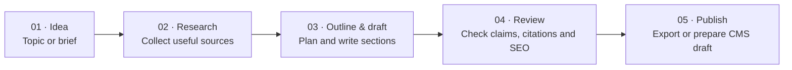
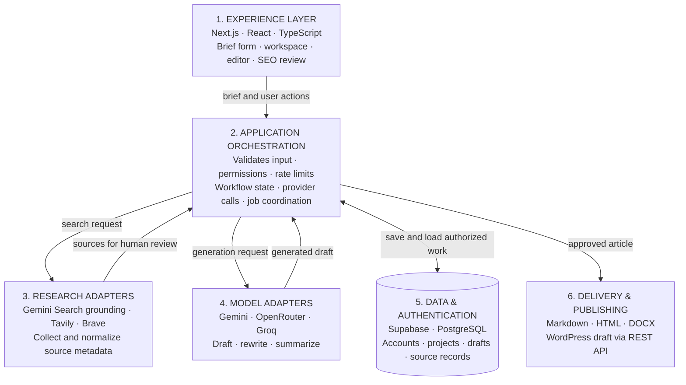

# Inkora AI

<h3 align="center">Research. Write. Publish.</h3>
<p align="center">Turn a small idea into a thoughtful, evidence-aware, search-ready article.</p>

<p align="center">
  
  
  
  
</p>

<p align="center">
  <a href="#overview">Overview</a> ·
  <a href="#product-workflow">Workflow</a> ·
  <a href="#architecture">Architecture</a> ·
  <a href="#getting-started">Getting started</a> ·
  <a href="#deployment">Deployment</a>
</p>

---

## Overview

**Inkora AI** is being built as a research and long-form writing studio. The goal is to help creators move from a topic, rough paragraph or scattered notes to a structured article with traceable sources, useful SEO metadata and a clear publishing path.

It is designed as a complete writing workflow rather than a one-click text generator:

- Understand the brief, audience and search intent.
- Discover and organize useful research sources.
- Create an editable outline before drafting.
- Draft long-form content section by section.
- Keep citations and evidence review close to the writing.
- Refine the article, SEO details and internal-link opportunities.
- Export the work or prepare a WordPress draft.

> **Project status:** This repository currently contains the initial Next.js scaffold and a Warm Editorial landing-page foundation. The research, AI generation, authentication, database, editor, export and publishing integrations described below are product direction—not shipped functionality yet.

## Product workflow



| Stage | What happens | Intended result |
|---|---|---|
| 01 — Idea | Add a topic, paragraph, rough notes or content brief | A clear writing brief |
| 02 — Research | Discover sources and collect relevant evidence | Organized source material |
| 03 — Outline & draft | Plan headings and write section by section | A structured article |
| 04 — Review | Check citations, claims, readability and SEO | A stronger, reviewable draft |
| 05 — Publish | Export or connect a publishing destination | A portable article or CMS draft |

### Intended feature areas

| Area | Planned capabilities | Status |
|---|---|---|
| Writing brief | Topic, audience, tone, language, angle and length | Planned |
| Research | Search adapters, source collection and metadata | Planned |
| Article generation | Outline-first, section-based drafting and rewrites | Planned |
| Evidence review | Source links, claim flags and manual verification | Planned |
| SEO workspace | Title, description, slug, keywords, FAQs and links | Planned |
| Editor | TipTap rich-text editing, autosave and revisions | Planned |
| Export | Markdown, HTML and DOCX | Planned |
| Publishing | WordPress connection, draft and confirmed publish flow | Planned |
| Workspace | Authentication, projects and article history | Planned |
| Starter interface | Next.js shell, Warm Editorial landing page and theme toggle | Scaffold present |

## Visual identity — Warm Editorial

Inkora should feel like a thoughtful writing desk: warm, quiet, tactile and focused. The visual language uses natural paper tones, deep ink-like typography and restrained terracotta accents.

| Token | Suggested color | Usage |
|---|---|---|
| Warm ivory | `#F5EFE5` | Main canvas |
| Paper white | `#FFFAF2` | Cards and editor surfaces |
| Deep espresso | `#49372D` | Main typography and dark surfaces |
| Muted terracotta | `#B96F52` | Primary accent and actions |
| Warm copper | `#C08A6D` | Secondary accent |
| Sand | `#EADFD1` | Subtle panels |
| Taupe | `#8A7465` | Supporting text |

**Typography direction:** expressive editorial serif for display headings, paired with a highly readable sans-serif for controls and body copy.

**Design principles**
- Spacious layouts and clear typographic hierarchy.
- Soft borders and restrained, natural shadows.
- Subtle motion that supports orientation, not distraction.
- Responsive layouts for mobile, tablet and desktop.
- Light and dark themes, with the Warm Editorial palette defining the light experience.
- Avoid glossy gradients, loud neon colors and unnecessary dashboard clutter.

## Architecture

The system is intended to keep the interface, orchestration, research services, model providers, persistence and publishing adapters independent. This makes providers replaceable and helps prevent UI code from becoming coupled to a single AI vendor.



**How to read this architecture**

1. **Experience:** User-facing workspace, brief form, editor and SEO review.
2. **Orchestration:** Server-side coordinator for validation, permissions, workflow state, rate limits and provider calls.
3. **Research:** Search adapters gather and normalize source metadata; users review sources before relying on them.
4. **Models:** Provider adapters handle drafting, rewriting and summarizing behind a common interface.
5. **Data:** Supabase/PostgreSQL is the proposed store for accounts, projects, drafts and source records.
6. **Delivery:** Export files or create a WordPress draft; require confirmation before live publishing.

**Request path:** Brief → validation → research → source/outline review → AI draft → editing and SEO checks → export or CMS draft.

> This is the planned architecture, not a claim that every integration is already implemented.

### How the architecture works

The architecture is organized as a request-and-response pipeline. Each layer has a focused responsibility, so the UI does not call model or research vendors directly.

1. **Experience layer — the writing desk:** The Next.js interface collects the topic, audience, tone, language and length. It displays the brief, outline, article editor, research sources and SEO review. It is responsible for presentation and user interaction.
2. **Application orchestration — the coordinator:** The server-side workflow validates the brief, checks permissions and rate limits, tracks the current stage, and decides which research or model operations are needed. It coordinates jobs and handles provider errors and timeouts.
3. **Research adapters — finding evidence:** A provider adapter sends a search request to an enabled research service, then normalizes returned pages into a consistent source format (title, URL, publisher and available metadata). Sources are presented for review; a search result is not automatically treated as proof that a claim is true.
4. **Model adapters — working with AI:** The orchestration layer sends the relevant brief, outline and reviewed source context to a configured model provider. Adapters provide a common interface for drafting, rewriting and summarizing, while keeping vendor-specific request formats out of the UI.
5. **Data and authentication — keeping work organized:** Supabase/PostgreSQL is the proposed home for accounts, projects, article drafts, settings and source records. Authentication and authorization must protect each user's data; server-only credentials stay on the server.
6. **Delivery — exporting or publishing:** The article can be prepared for Markdown, HTML or DOCX export. The WordPress adapter is intended to create a draft first; publishing should require an explicit user confirmation.

**Typical end-to-end flow:** User submits a brief → orchestration validates it → research adapters collect sources → the user reviews sources and outline → model adapter drafts sections → the user edits and checks claims/SEO → delivery exports the article or creates a WordPress draft.

**Important boundary:** This is the target design. The README's implementation snapshot below identifies which parts are currently scaffolded and which remain planned. A box in the diagram does not mean that integration is already implemented.

### Architecture responsibilities

| Layer | Responsibility |
|---|---|
| Experience | App shell, workspace, editor, source panel and SEO tools |
| Orchestration | Brief planning, workflow state, validation, permissions and job coordination |
| Research adapters | Search requests, source normalization and source metadata |
| Model adapters | Generation, rewriting, summarization and structured outputs |
| Data & auth | User accounts, projects, article drafts, settings and access control |
| Delivery | File exports and WordPress draft/publishing operations |

### Proposed technology stack

| Layer | Technology | Role |
|---|---|---|
| Web application | Next.js App Router | Routing and rendering |
| UI | React + TypeScript | Components and application logic |
| Styling | Tailwind CSS | Design system and responsive styling |
| Motion | Framer Motion | Interface transitions |
| Components | shadcn/ui + Lucide | Accessible UI building blocks |
| Editor | TipTap | Rich-text article editing |
| Database & auth | Supabase / PostgreSQL | Persistence and authentication |
| Validation | Zod | Input and provider response validation |
| Research | Gemini Search grounding, Tavily, Brave | Source discovery |
| Model inference | Gemini, OpenRouter, Groq | AI writing and editing |
| Publishing | WordPress REST API | CMS draft and publishing workflow |
| Runtime | Node.js / Docker | Portable deployment |

These are proposed choices, not a statement that every dependency or integration is already installed. The package manifest and lockfile are the source of truth for dependencies actually in use.

### Provider strategy

Research and model inference are separate concerns:

**Research providers (planned)**
- Gemini search grounding, where supported by the selected Gemini API.
- Tavily Search.
- Brave Search.

**Model providers (planned)**
- Google Gemini.
- OpenRouter.
- Groq.
- Nara Router, only after its official API contract, authentication, model support and request format have been verified.

Do not assume that a model provider automatically supplies reliable web research or citations. Keep each integration behind a server-side adapter, validate its response and preserve provider metadata. Provider names, model IDs, quotas and prices can change; verify official documentation before implementation.

### Suggested repository structure

The structure below is the intended direction as features are added. It is a guide, not a claim that all folders already exist.

```text
inkora-ai/
├── app/
│   ├── (auth)/                 # Sign-in and account routes
│   ├── (workspace)/            # Protected writing workspace
│   ├── api/                    # Server-side API routes
│   ├── layout.tsx
│   ├── page.tsx
│   └── globals.css
├── components/
│   ├── brand/                  # Logo and brand elements
│   ├── editor/                 # Rich-text editor UI
│   ├── layout/                 # Navigation and page shells
│   ├── research/               # Sources and evidence panels
│   ├── seo/                    # SEO analysis components
│   └── ui/                     # Shared UI primitives
├── features/
│   ├── articles/               # Briefs, outlines and drafts
│   ├── projects/               # Project workspace
│   ├── publishing/             # Export and CMS workflows
│   └── settings/               # User and provider settings
├── lib/
│   ├── ai/
│   │   ├── providers/          # Model adapters
│   │   └── orchestration/      # Generation workflow
│   ├── research/
│   │   └── providers/          # Search adapters
│   ├── wordpress/              # WordPress client
│   ├── security/               # Auth and security helpers
│   ├── validation/             # Zod schemas
│   └── utils/
├── public/
│   └── brand/                  # SVG and app identity assets
├── docs/
│   └── assets/                 # README diagrams and illustrations
├── supabase/
│   └── migrations/             # Database migrations
├── tests/                      # Unit and integration tests
├── .env.example
├── Dockerfile                  # Add when container workflow is implemented
├── docker-compose.yml          # Add when self-host config is implemented
└── README.md
```

## Getting started

### Requirements

- Node.js LTS compatible with the Next.js version in the repository.
- npm.
- Git.
- A code editor or browser-based development environment.

### Clone and install

```bash
git clone https://github.com/NSKWeb/inkora-ai.git
cd inkora-ai
npm install
```

### Configure environment

Create a local environment file:

```bash
cp .env.example .env.local
```

The template may contain placeholders for future integrations. Only configure credentials for features that have actually been implemented.

```dotenv
# App
NEXT_PUBLIC_APP_URL=http://localhost:3000
APP_ENV=development

# Supabase (public project configuration)
NEXT_PUBLIC_SUPABASE_URL=
NEXT_PUBLIC_SUPABASE_ANON_KEY=

# Supabase (server-only secret)
SUPABASE_SERVICE_ROLE_KEY=

# Model providers — server only
GEMINI_API_KEY=
OPENROUTER_API_KEY=
GROQ_API_KEY=
NARA_ROUTER_API_KEY=

# Research providers — server only
TAVILY_API_KEY=
BRAVE_SEARCH_API_KEY=

# Optional: encryption key for stored integration credentials
INTEGRATION_ENCRYPTION_KEY=
```

**Never commit real API keys.** Server secrets must not use a `NEXT_PUBLIC_` prefix or be exposed in browser code.

### Run locally

```bash
npm run dev
```

Open [http://localhost:3000](http://localhost:3000).

### Current implementation snapshot

Present in the starter scaffold:
- Next.js App Router foundation.
- React and TypeScript configuration.
- Tailwind styling foundation.
- Warm Editorial landing-page UI.
- Light/dark theme toggle.
- Article-length selection and topic input in the starter experience.
- Initial SVG brand mark and environment template.

Not implemented yet:
- Real AI generation or live research.
- Supabase authentication, database schema or user workspace.
- TipTap editor and autosave.
- Citation verification and evidence review.
- SEO analysis engine.
- Markdown, HTML or DOCX export.
- WordPress connection and publishing.
- Production deployment validation.

The visible starter action is a UI/demo interaction; it should not be mistaken for a live AI generation pipeline.

## Deployment

The goal is to support managed Next.js hosting and self-hosted Node.js/VPS environments. Actual compatibility must be checked against the current code, build output, runtime limits and platform adapter.

| Platform | Intended route | Important checks |
|---|---|---|
| Vercel | Native Next.js deployment | Environment variables, build and server runtime |
| Netlify | Next.js framework support | Adapter behavior and supported Next.js features |
| VPS / cloud VM | Node.js process or Docker | Node version, reverse proxy, HTTPS, process manager and backups |
| Docker host | Container image / Compose | Health checks, persistent storage and secrets |
| Antideploy | Platform-specific configuration | Confirm build command, Node runtime, output mode and environment handling |

### VPS production outline

1. Provision a supported Node.js runtime or Docker host.
2. Configure environment variables using a server-side secret store.
3. Build the application in a clean environment.
4. Run the app behind a reverse proxy such as Nginx or Caddy.
5. Enable HTTPS and secure cookies.
6. Configure database access, backups and migrations.
7. Add health checks, logs and error monitoring.
8. Move long-running research/generation work to a queue or worker if request limits require it.

Do not claim a platform is deployment-ready until a clean production build and a deployment smoke test have passed on that platform.

## Security, privacy & reliability

- Keep model, search and WordPress secrets server-side.
- Authenticate users and authorize every private resource.
- Use database Row Level Security for user-owned records.
- Validate user input and provider responses.
- Apply rate limits, timeouts, payload limits and retry policies.
- Protect URL fetching against SSRF, private-network access and unsafe redirects.
- Treat web pages and external documents as untrusted data, never as system instructions.
- Avoid logging secrets, prompts or private drafts unnecessarily.
- Encrypt stored integration credentials and restrict access.
- Require explicit confirmation before publishing or scheduling.
- Provide sensible deletion and retention controls.
- Show users when a claim is uncertain or needs manual verification.

AI-generated sources and fact-check labels are not a guarantee of truth. Human review is essential, especially for health, legal, financial, safety and other high-impact topics.

## Quality checklist

Before a feature is marked complete, test the whole user journey—not only the screen.

- [ ] Clean dependency install and production build.
- [ ] Authentication and protected-route behavior.
- [ ] Authorization and Row Level Security tests.
- [ ] Input validation, rate limiting and request timeouts.
- [ ] Provider adapter success, error and timeout tests.
- [ ] Source normalization and citation preservation.
- [ ] Outline and article generation at supported lengths.
- [ ] Editor autosave and revision recovery.
- [ ] Markdown, HTML and DOCX export integrity.
- [ ] WordPress draft flow and explicit publish confirmation.
- [ ] SSRF and unsafe URL-fetch tests.
- [ ] Responsive, keyboard and accessibility checks.
- [ ] Light and dark theme consistency.
- [ ] Deployment smoke test on each claimed platform.

## Roadmap

- [x] Initial repository and Next.js scaffold.
- [x] Warm Editorial landing-page foundation.
- [x] Initial SVG brand mark and README diagrams.
- [ ] Complete responsive workspace shell and navigation.
- [ ] Authentication and protected projects.
- [ ] Article brief and outline planner.
- [ ] Research provider adapter layer.
- [ ] Model provider adapter layer.
- [ ] Evidence-aware article generation.
- [ ] TipTap editor and revision history.
- [ ] SEO and article review workspace.
- [ ] Markdown, HTML and DOCX export.
- [ ] WordPress integration.
- [ ] Automated tests and production hardening.
- [ ] Verified Vercel, Netlify, Antideploy and VPS deployment guides.

## Contributing

Inkora AI is under active development. For a substantial change, open an issue first so the scope can be discussed. Keep provider integrations modular, never commit credentials, add tests for new behavior and update this README when setup, environment variables or deployment steps change.

## License

No license has been added yet. Until a license is included in this repository, do not assume the code is available for unrestricted reuse, modification or redistribution.

---

<p align="center">
  <strong>Inkora AI</strong><br>
  <em>Research. Write. Publish.</em><br>
  Made for ideas worth developing.
</p>
