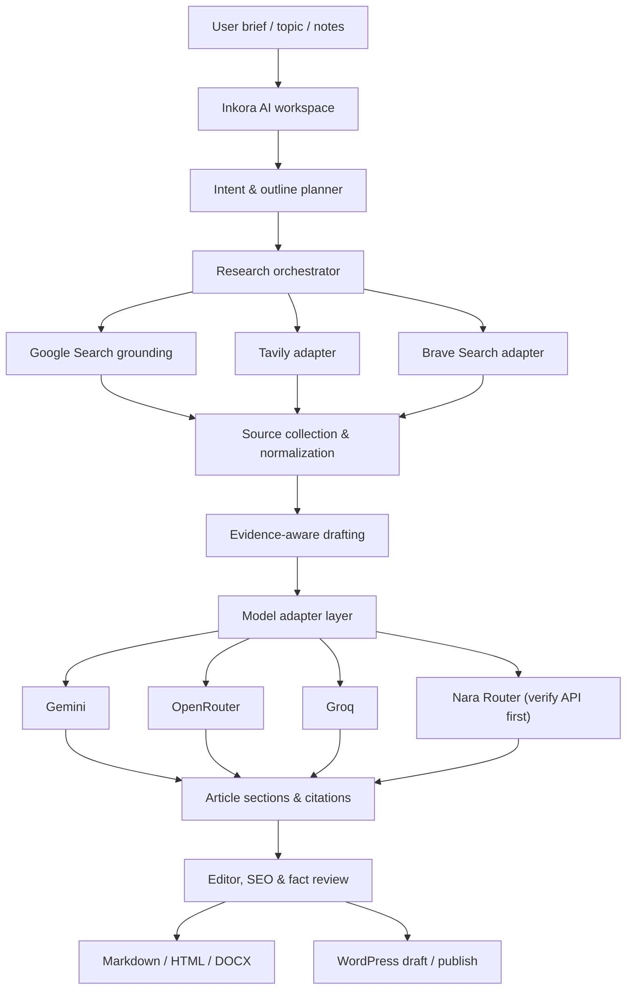

# Inkora AI
### Research. Write. Publish.

> Turn a small idea into a thoughtful, evidence-aware, search-ready article.

**Inkora AI** is an AI-powered research and long-form writing studio designed to help creators move from an initial topic or rough notes to a structured, well-researched, SEO-conscious article — then refine it in an editor and prepare it for publishing.

<p align="center">
  <strong>Research with context · Write with clarity · Publish with confidence</strong>
</p>

---

## ✦ Brand & visual direction

Inkora AI follows a **Warm Editorial** identity: calm, tactile, natural and readable.

| Role | Direction |
| --- | --- |
| Primary background | Warm ivory / soft cream |
| Surfaces | Paper white / light beige |
| Primary text | Deep espresso / mocha |
| Accent | Muted terracotta / warm copper |
| Supporting tones | Sand, taupe and natural brown |
| Typography | Editorial serif for expression, clean sans-serif for interface |
| Mood | Natural daylight, paper texture, understated and focused |

**Tagline:** Research. Write. Publish.

The identity should feel like a modern writing desk rather than a generic AI dashboard. Use restrained shadows, generous whitespace, fine borders, quiet transitions and clear hierarchy. Avoid excessive gradients, glossy effects, decorative clutter and high-saturation accents.

### Brand asset direction

The logo concept combines a feather/quill with an open book: the feather represents ideas and craft; the book represents knowledge and publishing. Keep the mark simple enough to work as a small favicon and app icon.

Suggested asset locations (add final production exports here as they are prepared):

```
public/
  brand/
    inkora-logo.svg
    inkora-mark.svg
    inkora-wordmark.svg
    inkora-logo-light.svg
    inkora-logo-dark.svg
  favicon.ico
  icon.svg
  apple-touch-icon.png
  og-image.png
```

> Artwork concepts are not yet committed as production SVG assets. Replace this note when the final vector exports are added.

---

## ✦ What Inkora AI is intended to do

Inkora AI is planned as a full-stack writing workflow, not just a one-shot text generator.

1. **Start with an idea** — enter a topic, paragraph, outline, rough notes or a content brief.
2. **Understand the intent** — identify the audience, topic angle, search intent and useful subtopics.
3. **Research the subject** — gather relevant source material through configured research providers.
4. **Build an outline** — create an editable H1/H2/H3 structure before drafting.
5. **Draft in sections** — generate a coherent long-form article while retaining research context.
6. **Review the evidence** — inspect source links, claims and areas that need human verification.
7. **Optimize for search** — prepare SEO title, description, slug, keywords, FAQs and linking suggestions.
8. **Edit and refine** — polish the article in a rich-text editor and keep useful revisions.
9. **Prepare to publish** — export content or send it to a connected WordPress site as a draft.

The features below describe the intended product direction. They should not be interpreted as implemented or production-ready until the corresponding code, tests and integrations are present.

## ✦ Planned capabilities

### 1. Idea-to-article workflow
- Topic, rough paragraph, notes and brief input modes
- Audience, tone, language and article-angle controls
- Article length presets:
  - Auto
  - Quick: 600–900 words
  - Standard: 1,000–1,500 words
  - Detailed: 1,500–2,500 words
  - Comprehensive: 2,500–4,000 words
  - Custom word target
- Outline-first workflow with editable headings
- Section-by-section drafting for better control and continuity

### 2. Research and source grounding
Research and model inference are separate layers in the architecture.

**Research provider integrations planned**
- Google Search grounding through supported Gemini capabilities
- Tavily Search
- Brave Search

**Model inference providers planned**
- Google Gemini
- OpenRouter
- Groq
- Nara Router, subject to verification against its official API documentation before implementation

Provider availability, model names, request formats, quotas and pricing can change. Implement each provider behind a server-side adapter and verify its current official API contract before enabling it. Do not assume that every model provider supplies web research or citations.

### 3. Evidence-aware writing
- Keep source metadata alongside research notes
- Preserve source URLs and publication details when available
- Attach citations to relevant article claims
- Identify claims needing manual review
- Distinguish supported, partially supported, conflicting and unverified statements
- Treat fetched web pages as untrusted reference material, never as instructions to the AI system

AI-generated citations and fact-check labels are assistance, not a guarantee of truth. Human review remains essential, especially for health, legal, financial, safety and other high-impact topics.

### 4. SEO workspace
- SEO title and meta description
- Suggested URL slug
- Primary and secondary keyword ideas
- Search intent and topic coverage
- FAQ suggestions
- Internal and external link opportunities
- Structured-data recommendations where appropriate
- Readability and content completeness checks

SEO recommendations should support useful content, not keyword stuffing or unsupported ranking promises.

### 5. Writing editor
Planned editor experience:
- Rich-text editing with TipTap
- Heading, paragraph, list, quote, link and image controls
- Rewrite, expand, shorten and regenerate selected passages
- Regenerate individual sections without losing the rest of the article
- Autosave and revision history
- Source/reference side panel
- Word count and reading-time estimates

### 6. Export and publishing
- Markdown export
- HTML export
- DOCX export
- WordPress REST API integration
- Multiple WordPress site connections
- Draft as the default publishing state
- Publish or schedule only after an explicit user action and confirmation

### 7. Workspace and account
- Authentication and protected workspaces
- Projects and article history
- Saved briefs and reusable writing preferences
- Usage visibility and provider-level error reporting

---

## ✦ Architecture

The design separates the user interface, orchestration, model providers, research connectors and publishing adapters. This keeps providers replaceable and reduces tight coupling.



### Proposed technology stack

| Layer | Proposed technology | Responsibility |
| --- | --- | --- |
| Web app | Next.js App Router | Routing, rendering and application shell |
| UI | React + TypeScript | Reusable interface and application logic |
| Styling | Tailwind CSS + shadcn/ui | Consistent design system |
| Motion | Framer Motion | Restrained interface transitions |
| Rich-text editor | TipTap | Article creation and refinement |
| Data and auth | Supabase | PostgreSQL, authentication and row-level security |
| Validation | Zod | Validate requests and provider payloads |
| Research | Gemini grounding, Tavily, Brave | Source discovery and retrieval |
| Model inference | Gemini, OpenRouter, Groq; Nara after verification | Generation and editing |
| Publishing | WordPress REST API | Draft and publishing workflows |
| Deployment | Node.js / Docker | Portable production runtime |

This is the intended stack, not a claim that the repository already contains these dependencies or integrations. The implementation should record actual versions in the package manager lockfile.

### Suggested project structure

The structure can evolve as the implementation is built. Keep provider and business logic isolated from UI components.

```
inkora-ai/
├── app/
│   ├── (auth)/
│   ├── (workspace)/
│   ├── api/
│   ├── layout.tsx
│   └── globals.css
├── components/
│   ├── brand/
│   ├── editor/
│   ├── layout/
│   ├── research/
│   ├── seo/
│   └── ui/
├── features/
│   ├── articles/
│   ├── projects/
│   ├── publishing/
│   └── settings/
├── lib/
│   ├── ai/
│   │   ├── providers/
│   │   └── orchestration/
│   ├── research/
│   │   └── providers/
│   ├── wordpress/
│   ├── security/
│   ├── validation/
│   └── utils/
├── public/
│   └── brand/
├── supabase/
│   └── migrations/
├── tests/
├── .env.example
├── Dockerfile
├── docker-compose.yml
└── README.md
```

---

## ✦ Security and reliability principles

Security is part of the product architecture, not a finishing task.

- Keep all AI, search and publishing secrets on the server.
- Never expose provider keys in browser bundles, client-side environment variables or logs.
- Store WordPress credentials securely; encrypt secrets at rest and restrict access.
- Enforce authentication and per-user authorization on every private resource.
- Use Supabase Row Level Security for user-owned records.
- Validate and bound all user input and provider responses.
- Apply rate limits, request timeouts, payload limits and clear error handling.
- Protect URL-fetching features against SSRF, private-network access and unsafe redirects.
- Treat research pages and external documents as untrusted data.
- Avoid logging prompts, credentials or sensitive article content unnecessarily.
- Require explicit confirmation before publishing or scheduling content.
- Provide deletion and retention controls for user content and connected credentials.

---

## ✦ Local development

### Prerequisites

- Node.js LTS compatible with the selected Next.js release
- npm (or the package manager selected by the repository)
- Git
- Supabase project for database and authentication features
- API credentials for whichever providers are enabled

### Setup

The commands below describe the expected workflow once the application scaffold and package scripts have been committed.

```bash
git clone https://github.com/NSKWeb/inkora-ai.git
cd inkora-ai
npm install
```

Create a local environment file:

```bash
cp .env.example .env.local
```

Add only the credentials required for the features you are configuring. Then start the development server:

```bash
npm run dev
```

Open `http://localhost:3000`.

> **Current status:** the initial Next.js application scaffold, Warm Editorial landing page, theme toggle, project configuration and brand mark are now committed. AI generation, live research integrations, authentication, persistent storage, rich-text editing and WordPress publishing are not implemented yet.

### Environment variable template

Use placeholders only. Never commit real API keys.

```dotenv
# Application
NEXT_PUBLIC_APP_URL=http://localhost:3000
APP_ENV=development

# Supabase - public project values
NEXT_PUBLIC_SUPABASE_URL=
NEXT_PUBLIC_SUPABASE_ANON_KEY=

# Supabase - server only
SUPABASE_SERVICE_ROLE_KEY=

# AI model providers (server only)
GEMINI_API_KEY=
OPENROUTER_API_KEY=
GROQ_API_KEY=
NARA_ROUTER_API_KEY=

# Research providers (server only)
TAVILY_API_KEY=
BRAVE_SEARCH_API_KEY=

# Optional encryption key for stored integration credentials
INTEGRATION_ENCRYPTION_KEY=
```

Only add a variable when its integration is actually implemented. Confirm current provider environment-variable requirements against official documentation before release.

---

## ✦ Deployment

The goal is a portable Node.js application that can be deployed on managed platforms or a VPS. Deployment support must be validated against the actual build output and platform constraints.

| Target | Deployment approach | Notes |
| --- | --- | --- |
| Vercel | Next.js deployment | Convenient for the standard Next.js runtime; configure environment variables |
| Netlify | Next.js framework/runtime support | Verify supported Next.js features and adapter/runtime behavior |
| VPS | Node.js or Docker | Reverse proxy, HTTPS, process management and backups |
| Docker host | Docker image / Compose | Portable self-hosted option |
| Antideploy | Platform-specific build configuration | Verify supported runtime, build command and environment-variable handling before claiming compatibility |

### Expected production checks

- Build completes successfully in a clean environment
- Environment variables are configured in the deployment dashboard or secret manager
- Database migrations are applied
- Auth callback URLs and allowed origins are correct
- HTTPS and secure cookies are enabled
- Background/long-running tasks use an appropriate queue or worker runtime
- Uploads and generated files use durable storage where required
- Logs and health checks are configured
- Database backups and recovery have been tested

Do not assume that every serverless platform supports long-running research and generation requests. Use a background job/queue architecture where provider latency, retries or document processing exceed request limits.

---

## ✦ Quality, testing and release checklist

Before calling a feature complete, test its full path rather than only its UI.

- [ ] Clean install and production build
- [ ] Authentication and protected-route checks
- [ ] Authorization and row-level security tests
- [ ] Request validation and rate-limit tests
- [ ] Provider adapter tests with mocked success, timeout and error responses
- [ ] Research source normalization and citation preservation
- [ ] Draft generation at every supported length
- [ ] Editor autosave and revision recovery
- [ ] Export integrity for Markdown, HTML and DOCX
- [ ] WordPress draft flow and explicit publish confirmation
- [ ] SSRF and unsafe URL-fetch tests
- [ ] Responsive layout and accessibility checks
- [ ] Dark mode and Warm Editorial light theme consistency
- [ ] Production deployment smoke test

---

## ✦ Product principles

1. **Evidence before confidence** — show sources and uncertainty instead of presenting every generated statement as verified fact.
2. **Human control** — keep outlines, article sections and publishing decisions editable.
3. **Provider flexibility** — use adapters so models and research services can be replaced.
4. **Quiet design** — make the interface useful, spacious and distraction-free.
5. **Privacy by design** — protect drafts, credentials and research history.
6. **Honest status** — never label planned integrations as live or tested.

## ✦ Roadmap

The roadmap is directional; items are not complete merely because they appear here.

- [ ] Repository scaffold and design tokens
- [ ] Responsive application shell and theme system
- [ ] Authentication and project workspace
- [ ] Article brief and outline planner
- [ ] Research provider adapter layer
- [ ] Model provider adapter layer
- [ ] Evidence-aware long-form generation
- [ ] TipTap editor and revision history
- [ ] SEO and article review workspace
- [ ] Markdown, HTML and DOCX export
- [ ] WordPress integration
- [ ] Tests, observability and production hardening
- [ ] Deployment recipes and verified platform builds

## ✦ Contributing

This project is under active development. For substantial changes, open an issue first to discuss the scope. Keep provider integrations modular, avoid committing secrets, add tests for new behavior and update documentation when setup or configuration changes.

## ✦ License

No license has been added yet. Unless and until a license is included in this repository, do not assume that the source is available for unrestricted reuse, modification or redistribution.

---

<p align="center">
  <strong>Inkora AI</strong><br/>
  <em>Research. Write. Publish.</em><br/>
  Built for ideas worth developing.
</p>
